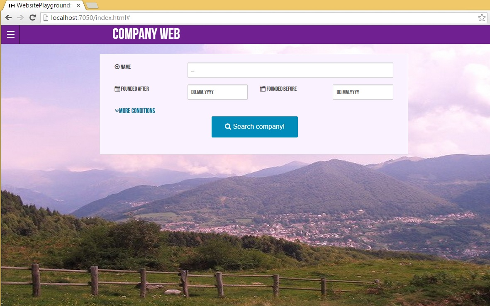

# Website-playground (net48-ssdt) #

This repository has 4 different git-branches as templates to choose from:

- [Dotnet 8.0 with Microsoft SQL Server + SSDT (dacpac)](https://github.com/Thorium/WebsitePlayground/tree/dotnet-ssdt)
- [.Net Framework 4.8.1 with Microsoft SQL Server + SSDT (dacpac)](https://github.com/Thorium/WebsitePlayground/tree/net48-ssdt)
- [Dotnet 8.0 with MySQL (MariaDB)](https://github.com/Thorium/WebsitePlayground/tree/dotnet-mysql)
- [.Net Framework 4.8.1 with MySQL (MariaDB)](https://github.com/Thorium/WebsitePlayground/tree/net48-mysql)

## Overview ##

This is yet another template for web-sites (a.k.a. playing with some technologies).
What are the key points:

- The same web-server works on Mac / Windows / Ubuntu.
- No O/R-mapping, no n-tiers, no huge amount of manual object-to-object-mapping
- No direct SQL-clauses, no SQL-injection problems.
- No APIs inside one software. Not SOAP nor REST.
- Real-time communication between server and clients.

Technology-stack:

- General: Git, Markdown
- SQL-Server: [SQLProvider](https://github.com/fsprojects/SQLProvider) supports any: MS-SQL/Postgres/Oracle/MySql/MariaDB/SQLite/MS-Access. Instructions for MariaDB are included; MySql should work as well. Also, some for SQLite database and MS-SQL scripts if you want to use those.
- Backend: F# (FSharp), Paket, TypeProviders, OWIN, SignalR (WebSockets/Long-Polling), Logary
- Frontend: Gulp, React.js, Less/Sass, Bootstrap or Foundation.css, FontAwesome, Lodash, jQuery / jQuery-UI, TypeScript / ES6. The demo site is Foundation, but infra supports Bootstrap notation as well.
- Maybe in the future: Crossroads.js, Rx/Rx.Js, FsUnit.xUnit, Canopy 

Documentation:

- [More about the Technology-stack](specifications/Technologies.md)
- [How to install the environment](specifications/Deployment.md)
- [General developer instructions](specifications/Development.md)
- [How to copy this template as a new project](specifications/NewProject.md)

There are two screens: 1) You can search for companies. 2) CRUD-operations for companies.

Sign-in is chosen with the `AuthProvider` setting in `backend/app.config`:

- `Local`: email and password in the users table, with registration (the default).
- `Cognito`: an Amazon Cognito user pool with a Hosted UI domain. Set `AuthCognitoUserPoolId` and `AuthClientId`.
- `Auth0`: an Auth0 tenant. Set `AuthDomain` and `AuthClientId`, and `AuthAudience` when the site calls an API.
- `Oidc`: any other OpenID Connect provider, such as Entra ID or Keycloak. Set `AuthAuthority` and `AuthClientId`.

External providers sign in with the authorization code flow and PKCE, and need `AuthClientSecret` unless the
app client is public. Register `https://<site>/signin-oidc` as a callback URL and `https://<site>/login.html` as
a sign-out URL. With an external provider the email and password routes are off, and sign-out also ends the
provider's session.

